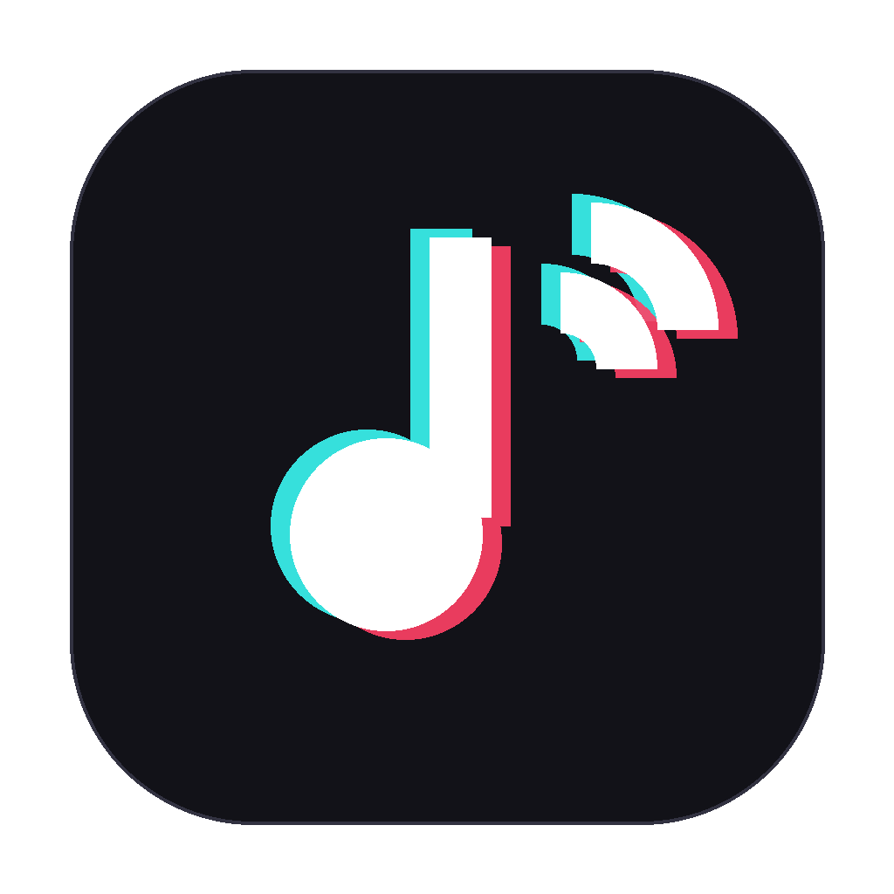

# TokMac 🎵

<p align="center">
  
</p>

<p align="center">
  <b>A lightweight, distraction-free desktop app for TikTok (macOS & Windows).</b><br>
  极简、沉浸、超轻量的 TikTok 桌面客户端（支持 macOS 与 Windows）。
</p>

<p align="center">
  
  
  
  
</p>

---

## 📥 下载安装 / Downloads

前往 [**GitHub Releases**](https://github.com/leeeway/TokMac/releases/latest) 下载对应平台最新版本：

| 平台 (Platform) | 下载文件 (File) | 说明 (Description) |
| :--- | :--- | :--- |
| **macOS** | [`TokMac-1.0.0.dmg`](https://github.com/leeeway/TokMac/releases/latest) | 双击打开 DMG，拖入 Applications 即可使用 |
| **Windows** (安装向导) | [`TokMac-Setup-1.0.0.exe`](https://github.com/leeeway/TokMac/releases/latest) | Windows 快速安装向导，自动创建桌面与开始菜单图标 |
| **Windows** (免安装便携版) | [`TokMac-Windows-Portable.zip`](https://github.com/leeeway/TokMac/releases/latest) | 解压后双击 `TokMac.exe`，需安装 WebView2 Runtime |

---

## ✨ 核心亮点 / Features

- 🖥️ **跨平台原生引擎**：
  - **macOS**：基于 Swift + WebKit 原生架构，提供 Apple Silicon / Intel Universal 应用。
  - **Windows**：基于 .NET 8 + Microsoft Edge WebView2 打造，支持 Windows 11 暗黑主题与任务栏进度。
- 📱/💻 **双模式一键切换**：
  - **宽屏舒适模式 (1080×760)**：完整展现频道侧边栏与视频，右侧评论区宽敞展开，阅读互动毫无遮挡。
  - **竖屏挂屏模式 (520×840)**：仿手机黄金比例，边写代码边摸鱼刷视频。
- ⬇️ **视频智能下载 & 实时进度**：
  - 支持快捷键 `Cmd+S` / `Ctrl+S`、工具栏按钮及鼠标右键下载。
  - 自由弹窗选择保存文件夹与文件名。
  - 原生悬浮进度条（HUD），实时显示下载进度与大小，下载完成可一键在访达/资源管理器中直达定位。
  - 同时进行一个下载；先保存到目标目录的临时文件，成功后再原子替换，失败或取消不会截断已有视频。
  - Blob 视频交给浏览器原生流式下载，不再通过网页消息传输整段 Base64；MediaSource 等不可下载的视频流会显示错误。
- 📌 **窗口一键置顶 (Always on Top)**：点击工具栏或按快捷键置顶，保持窗口永远浮在其他软件之上。
- 🔐 **支持完整账号登录 & 长期免登**：持久化保留 Cookies & Session，完美支持 Google、Apple ID、手机验证码等登录。
- 🧼 **纯净去干扰**：自动过滤各类下载手机 App 的干扰横幅，还原纯净浏览体验。

---

## ⌨️ 常用快捷键 / Keyboard Shortcuts

| 功能 (Feature) | macOS 快捷键 | Windows 快捷键 |
| :--- | :--- | :--- |
| **下载当前视频** | `Cmd + S` | `Ctrl + S` |
| **切换窗口置顶** | `Cmd + T` | `Ctrl + T` |
| **切换竖屏小窗** | `Cmd + 1` | `Ctrl + 1` |
| **切换宽屏桌面** | `Cmd + 2` | `Ctrl + 2` |
| **刷新页面** | `Cmd + R` | `F5` / `Ctrl + R` |
| **全屏切换** | `Cmd + Ctrl + F` | `F11` |

---

## 🛠️ 本地编译构建 / Build from Source

### macOS (Swift)

需要 macOS 13+ 和支持 Swift 5.9+ 的 Xcode Command Line Tools。构建脚本会分别编译 arm64、x86_64，再合并为 Universal 应用。

```bash
git clone https://github.com/leeeway/TokMac.git
cd TokMac
./create_dmg.sh
```

输出位于 `build/`。构建和打包不会安装、删除或替换 `/Applications` 中的应用；需要安装时，将生成的 `TokMac.app` 拖入 Applications。

### Windows (.NET 8 + WebView2)

需要 .NET 8 SDK；运行应用需要 Windows 10 1809+ / Windows 11 和 Microsoft Edge WebView2 Runtime（.NET 自包含发布不包含此浏览器运行时）。

```powershell
git clone https://github.com/leeeway/TokMac.git
cd TokMac\windows
dotnet publish TokMac.csproj -c Release -r win-x64 --self-contained true -p:PublishSingleFile=true -o ..\build_win
```

### 验证与版本发布

```bash
# 两个平台共用的浏览器脚本回归测试（需要 Node.js 18+）
node --test tests/scripts.test.cjs

# macOS 响应校验、原文件保护和本地 Blob 下载集成测试
./tests/run-swift-tests.sh --webkit

# 跨平台文件保存检查（需要 .NET 8 SDK）
dotnet run --project tests/windows/DownloadFileTests.csproj -c Release
```

默认版本读取仓库根目录的 `VERSION`。CI 的普通推送和 PR 仅测试、构建并保存产物；推送 `vX.Y.Z` 标签时，所有产物使用标签版本，并创建对应 Release。已有 Release 的附件不会被自动覆盖。

---

## 📄 开源许可 / License

本项目基于 [MIT 许可证](LICENSE) 开源发布。
